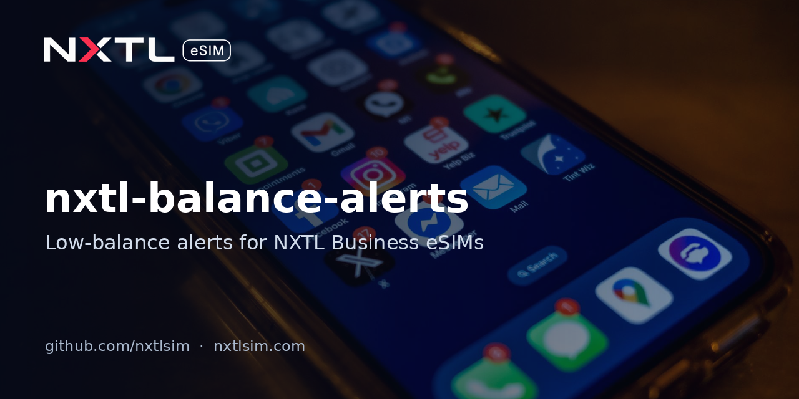

# nxtl-balance-alerts



Get a Telegram, Slack or email alert before your NXTL Business eSIM balance runs dry. One Python file, or a ready-made GitHub Action you schedule with cron.

> **Status:** Built against the published API reference; not yet tested against the live API.
> Maintained by [NXTL eSIM](https://nxtlsim.com).

## Who it's for
- Teams running staff phones, routers, backup lines or IoT devices on a pooled [NXTL Business](https://nxtlsim.com/for-business/) balance.
- Developers who want a low-balance warning without building a dashboard.

API keys (`X-NXTL-Key`) are issued only to approved NXTL Business accounts. Apply via [nxtlsim.com/for-business](https://nxtlsim.com/for-business/).

## What it does
1. Calls `GET /balance` (pool totals + per-eSIM wallets) and `GET /usage/summary?days=N` on `https://nxtlsim.com/api/v1`.
2. Compares the pooled balance with your threshold.
3. If it is below, posts the message to every channel you configured: Telegram, Slack incoming webhook, and/or SMTP email.
4. Exits with code `2` when the balance is low (handy for CI), `0` otherwise.

The API reference does not publish the exact JSON field names of the `/balance` response, so the tool tries common names (`pool.available`, `balance`, `available`, ...). Run once with `--json` and pin the right one with `--balance-field`.

## Quick start (CLI)
```bash
pip install -r requirements.txt
export NXTL_API_KEY=your_key
export SLACK_WEBHOOK_URL=https://hooks.slack.com/services/...   # optional
python nxtl_balance_alerts.py --threshold 25 --json --dry-run   # inspect responses
python nxtl_balance_alerts.py --threshold 25 --balance-field pool.available
```

| Variable | Purpose |
|---|---|
| `NXTL_API_KEY` | Required. Key with `balance:read` and `usage:read` scopes |
| `TELEGRAM_BOT_TOKEN`, `TELEGRAM_CHAT_ID` | Telegram alerts |
| `SLACK_WEBHOOK_URL` | Slack incoming webhook |
| `SMTP_HOST`, `SMTP_PORT`, `SMTP_USER`, `SMTP_PASSWORD`, `SMTP_FROM`, `ALERT_EMAIL_TO` | Email alerts (STARTTLS) |

## Quick start (GitHub Action)
Add `NXTL_API_KEY` and your channel secrets as repository secrets, then create `.github/workflows/nxtl-balance.yml`:

```yaml
name: NXTL balance check
on:
  schedule:
    - cron: "0 */6 * * *"   # every 6 hours
  workflow_dispatch:
jobs:
  check:
    runs-on: ubuntu-latest
    steps:
      - uses: nxtlsim/nxtl-balance-alerts@main
        with:
          threshold: "25"
        env:
          NXTL_API_KEY: ${{ secrets.NXTL_API_KEY }}
          SLACK_WEBHOOK_URL: ${{ secrets.SLACK_WEBHOOK_URL }}
          TELEGRAM_BOT_TOKEN: ${{ secrets.TELEGRAM_BOT_TOKEN }}
          TELEGRAM_CHAT_ID: ${{ secrets.TELEGRAM_CHAT_ID }}
```

Tip: NXTL also supports server-side thresholds (notify or auto-suspend) and signed `balance.low` webhooks. See [nxtl-webhook-starter](https://github.com/nxtlsim/nxtl-webhook-starter) to receive them.

## Security
Keep `NXTL_API_KEY` in secrets only. Never commit it or put it in client-side code.

## Links
- NXTL eSIM: https://nxtlsim.com
- NXTL for Business: https://nxtlsim.com/for-business/
- API reference: https://nxtlsim.com/nxtl-api-reference/

## License
MIT © NXTL eSIM. This repository is maintained by NXTL eSIM.
